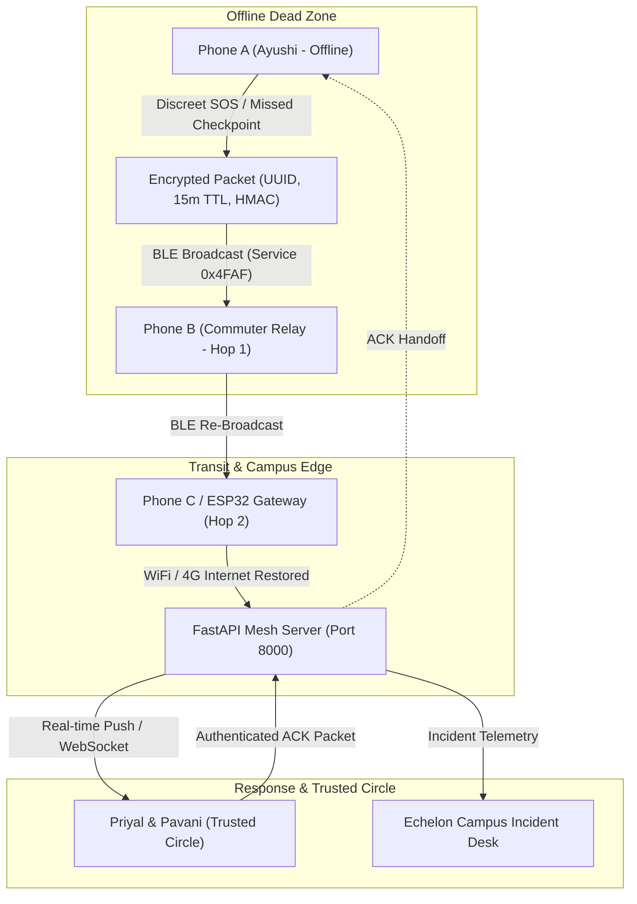

<<<<<<< HEAD
# ShaktiX
=======
# RAAHI (Resilient Assistance and Emergency Handoff Intelligence)
> **"When the network fails, your safety network doesn't."**  
> **HERHACK 2026** · Women’s Safety, AI, IoT, & Bluetooth Low Energy  
> **Team:** ShaktiX  
> **Members:** Priyal, Pavani, Ayushi Saxena  
> **Institution:** Echelon Institute of Technology, Faridabad  

---

## 🌟 Executive Summary & Innovation

Women traveling alone frequently encounter cellular network dead zones—underground metro routes, basement parking, isolated campus stretches, and rural transit corridors. Traditional panic buttons and SOS apps fail because they assume a working 4G/5G connection.

**RAAHI** is an **offline-first, privacy-governed personal safety and mesh handoff system**. It combines:
1. **Discreet Emergency Activation**: Silent cadence tap gesture or power button cadence with a 5-second grace window to eliminate false alarms.
2. **Offline BLE Emergency Packet Relay**: If cellular connectivity is dead, RAAHI synthesizes a tamper-evident, time-limited emergency packet (UUID, UTC, 15m TTL, HMAC-SHA256 signature, consented GPS) and broadcasts it peer-to-peer over Bluetooth Low Energy.
3. **Loop-Free Mesh Handoff**: Nearby opted-in devices (students, commuters, campus hubs, or ESP32 nodes) receive the packet, verify TTL, check duplicate caches, increment the hop count (max 3), and re-broadcast until an internet-connected node uploads it to the RAAHI FastAPI backend.
4. **Safe Journey Mode with Timed Checkpoints**: Configurable check-in intervals (e.g. 5, 10, 15m) with active countdown and one-touch "I Am Safe" confirmation.
5. **Deterministic Escalation & Explainable Risk Scoring**: If a checkpoint is missed, RAAHI prompts the user first (60s grace period). If unconfirmed, it deterministically escalates (Level 1: Audible prompt ➔ Level 2: Trusted Circle push ➔ Level 3: Offline BLE mesh flood). *No black-box predictive claims; every escalation reason is explainable.*
6. **Strict Privacy by Design**: Zero continuous audio eavesdropping, zero public location tracking, zero background surveillance, user-controlled cancellation, and auto-purging data retention.

---

## 🏗️ Architecture & Tech Stack



- **Frontend**: React 18, TypeScript, Tailwind CSS, Lucide Icons, Leaflet OpenStreetMap, Canvas Confetti.
- **Backend**: Python 3.13, FastAPI, Pydantic v2, Pytest, Cryptographic HMAC.
- **IoT Demonstration**: ESP32 C++ firmware (`iot/esp32_raahi_relay.ino`) with BLE GATT scanning and WiFi HTTP bridge.
- **Mobile Specification**: Flutter Android Native BLE advertising & scanning manager (`mobile_flutter/`).

---

## 📦 Project Structure

```
raahi-mvp/
├── backend/
│   ├── app/
│   │   ├── __init__.py
│   │   ├── main.py             # FastAPI entry point & CORS
│   │   ├── models.py           # Pydantic schemas (User, Event, Journey, RelayPacket)
│   │   ├── database.py         # Thread-safe demo state store
│   │   ├── packet_engine.py    # Expiry, deduplication cache, HMAC signature
│   │   ├── escalation.py       # Deterministic escalation & explainable risk engine
│   │   └── routes/
│   │       ├── auth.py         # Profile & consent management
│   │       ├── contacts.py     # Trusted circle CRUD
│   │       ├── emergency.py    # SOS trigger, lifecycle, ACK, cancel
│   │       ├── relay.py        # BLE packet ingestion & simulation hops
│   │       ├── journey.py      # Checkpoints, check-in, escalation
│   │       └── dashboard.py    # Telemetry & system reset
│   ├── tests/
│   │   ├── test_packet_engine.py # Expiry, loop prevention, deduplication tests
│   │   ├── test_escalation.py    # Escalation ladder & risk score tests
│   │   └── test_api_endpoints.py # End-to-end integration test suite
│   ├── requirements.txt
│   └── .env.example
├── frontend/
│   ├── src/
│   │   ├── components/
│   │   │   ├── Navbar.tsx                   # Top navigation & connectivity toggle
│   │   │   ├── HomeDashboard.tsx            # Screen 2: SOS center & Safe Journey card
│   │   │   ├── DiscreetSosModal.tsx         # Screen 3: Cadence tap & lifecycle stepper
│   │   │   ├── OfflineEmergencyMode.tsx     # Screen 4: BLE packet inspector & TTL timer
│   │   │   ├── SafeJourneyModal.tsx         # Screen 5: Config & escalation breakdown
│   │   │   ├── TrustedCircleView.tsx        # Screen 6: Guardian management
│   │   │   ├── EmergencyContactDashboard.tsx# Screen 7: Leaflet OSM map & ACK dispatch
│   │   │   ├── PrivacySettingsModal.tsx     # Screen 8: Permissions & data purge
│   │   │   ├── MultiDeviceSimView.tsx       # Screen 9: 4-Node Hackathon Judging Simulator
│   │   │   ├── AdminDashboardView.tsx       # Screen 10: Campus safety desk operations
│   │   │   └── OnboardingModal.tsx          # Screen 1: Team ShaktiX & Consent form
│   │   ├── api.ts              # API client with offline fallback
│   │   ├── types.ts            # TypeScript contracts
│   │   ├── App.tsx             # State orchestrator
│   │   └── main.tsx
│   ├── package.json
│   ├── vite.config.ts
│   └── tailwind.config.js
├── iot/
│   └── esp32_raahi_relay.ino   # ESP32 BLE relay & WiFi bridge firmware
├── mobile_flutter/
│   └── lib/ble/
│       └── raahi_ble_manager.dart # Android Native BLE Peripheral & Central specs
└── README.md
```

---

## 🚀 Quickstart: Run Locally in 2 Minutes

### 1. Start the Python FastAPI Backend
```powershell
cd backend
python -m pip install -r requirements.txt
uvicorn app.main:app --host 0.0.0.0 --port 8000 --reload
```
- API Docs: `http://localhost:8000/docs`
- Health check: `http://localhost:8000/api/health`

### 2. Start the React Frontend
In a second terminal:
```powershell
cd frontend
npm install
npm run dev
```
- Open `http://localhost:5173` in any browser!

---

## 🧪 Test Suite Execution

RAAHI includes a comprehensive automated test suite verifying packet expiry, duplicate drop, hop limit enforcement, and deterministic risk calculation:

```powershell
cd backend
python -m pytest tests -v
```

**Results:**
- `test_packet_creation_and_signature`: PASSED
- `test_packet_expiry`: PASSED (Rejects packets exceeding 15m TTL)
- `test_duplicate_packet_prevention`: PASSED (Drops identical packet IDs)
- `test_hop_count_limit_loop_prevention`: PASSED (Halts relay at 3 hops)
- `test_checkpoint_grace_period_and_missed`: PASSED (60s grace countdown)
- `test_deterministic_escalation_ladder`: PASSED (Level 0 ➔ Level 3)
- `test_explainable_risk_score`: PASSED (Deterministic score breakdown)
- `test_emergency_trigger_and_acknowledgement`: PASSED
- `test_relay_packet_duplicate_and_delivery`: PASSED

---

## 🛡️ Hackathon Demonstration Walkthrough (HERHACK 2026)

When presenting to judges:

1. **Screen 1 (Home Dashboard)**:
   - Notice the **"Offline Dead Zone"** toggle in the top bar. Click it to simulate loss of cellular data.
   - Hold the large SOS button for 1.2s or trigger the discreet 3-tap cadence.
   - Observe the **5-second grace window** allowing Ayushi to cancel accidental triggers.

2. **Screen 2 (Offline BLE Packet Inspector)**:
   - Watch the raw cryptographic packet created: `event_id`, UTC timestamp, `ttl_minutes: 15`, `signature_hmac`.
   - See the delivery honesty notice: *"Delivery is not guaranteed until an opted-in peer or bridge is in range."*

3. **Screen 3 (Multi-Device Mesh Simulator)**:
   - Switch to the **Mesh Simulator** tab.
   - Click **Step 1**: Phone A creates the packet in dead zone.
   - Click **Step 2**: Phone B (nearby student) relays the packet (Hop 1).
   - Click **Step 3**: Phone C / ESP32 bridges the packet over internet to the cloud (Delivered).
   - Click **Step 4**: Priyal clicks **"Acknowledge Alert"** on her phone, and the verified ACK packet is returned to Phone A!

4. **Screen 4 (Fault-Tolerance & Edge-Case Buttons)**:
   - Click **"Test Expiry Check"**: proves engine rejects expired packets.
   - Click **"Test Deduplication"**: proves deduplication filter drops duplicate loops.
   - Click **"Test Max Hop Limit"**: proves mesh circuit-breaker halts at hop count 3.

5. **Screen 5 (Safe Journey & Explainable Risk Score)**:
   - Trigger missed checkpoint escalation.
   - Observe the **Explainable Risk Score (95/100 - CRITICAL)**.
   - View transparent reasons: unconfirmed check-in + cellular loss.
   - Read the ethical disclaimer: *"A missed check-in indicates unconfirmed response, not proof of an attack."*

---

## 👥 Team ShaktiX Attribution
- **Priyal**: Mobile Architecture, BLE Mesh Protocol Design, & Product Strategy.
- **Pavani**: Backend Systems, Cryptographic Verification, & Threat Modeling.
- **Ayushi Saxena**: UI/UX Design, Safe Journey Escalation Logic, & Integration.
- **Institution**: Echelon Institute of Technology, Faridabad.
>>>>>>> c4461ed (feat: complete RAAHI MVP for HERHACK 2026 by Team ShaktiX)
